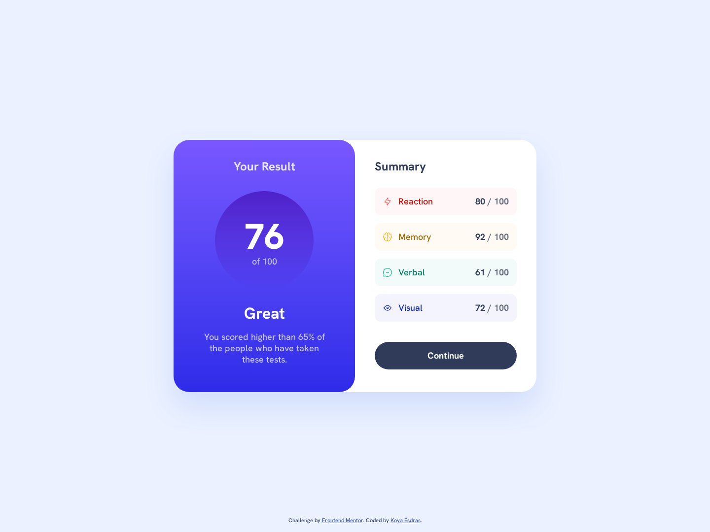

# Frontend Mentor - Results summary component solution

This is a solution to the [Results summary component challenge on Frontend Mentor](https://www.frontendmentor.io/challenges/results-summary-component-CE_K6s0maV). Frontend Mentor challenges help you improve your coding skills by building realistic projects.

## Table of contents

- [Overview](#overview)
  - [The challenge](#the-challenge)
  - [Screenshot](#screenshot)
  - [Links](#links)
- [My process](#my-process)
  - [Built with](#built-with)
  - [Workflow](#workflow)
  - [What I learned](#what-i-learned)
  - [Continued development](#continued-development)
  - [Useful resources](#useful-resources)
  - [AI Collaboration](#ai-collaboration)
- [Author](#author)

## Overview

### The challenge

Users should be able to:

- View the optimal layout for the interface depending on their device's screen size
- See hover and focus states for all interactive elements on the page

### Screenshot



### Links

- Solution URL: [frontendmentor.io/solutions/results-summary-with-tailwind-v4-wcag-aa-colours-and-playwright-tests-1ASfJTaZbq](https://www.frontendmentor.io/solutions/results-summary-with-tailwind-v4-wcag-aa-colours-and-playwright-tests-1ASfJTaZbq)
- Live Site URL: [ounokoya.github.io/results-summary-component](https://ounokoya.github.io/results-summary-component/)

## My process

### Built with

- Semantic HTML5: two sections named by their headings, a list for the four categories, a `button type="button"` for Continue
- [Tailwind CSS v4](https://tailwindcss.com/) — design tokens in `@theme`, default palette removed, named utilities for the repeated groups (`focus-ring`, `link`)
- Hanken Grotesk served with the site from the starter's variable font file
- No JavaScript for the interface: the content is written in the HTML (the `data.json` bonus was left aside on purpose)
- Mobile-first layout: mobile < 768 px, the desktop card from 768 px (my tablet proposal, no design provided)
- [Vite](https://vite.dev/) for the build, deployed on GitHub Pages from the `gh-pages` branch (`npm run deploy`)
- [Playwright](https://playwright.dev/), [axe-core](https://github.com/dequelabs/axe-core), the W3C Nu validator, html-validate and ESLint for tests

### Workflow

Before any code, the design was analysed and rebuilt:

1. **Visual analysis in Excalidraw** — measurements in px, contrast checks of every text, inventory of the interactive elements → [`specs/visuel/`](./specs/visuel/)
2. **Penpot mockup** — library, components with their hover and focus states, desktop, mobile and tablet screens, visual thresholds calibrated against the design JPGs → [`specs/visuel/penpot/`](./specs/visuel/penpot/)
3. **Spec, then tests** — 20 Given/When/Then scenarios and the accessible names the tests rely on → [`specs/specifications/`](./specs/specifications/); the tests were written before the code and checked to fail on the starter
4. **Decisions** — tokens, font, no JavaScript, centring the card with the footer → [`specs/adr/`](./specs/adr/)
5. **Code** — one commit per part (structure, mobile, desktop, states), then a walk-through in a real browser → [`specs/analyse/`](./specs/analyse/)

### What I learned

**Centring a card without letting the footer move it.** A footer placed under the card pushes it up by half the footer's height. A three-row grid keeps the card exactly in the middle and puts the attribution at the bottom, and the page still grows if the window is too short:

```html
<body class="md:grid md:min-h-dvh md:grid-rows-[1fr_auto_1fr]">
  <main class="md:row-start-2">…</main>
  <footer class="md:row-start-3 md:self-end">…</footer>
</body>
```

**Colours that pass WCAG AA.** Three category names, the "/ 100" and "Your Result" were below 4.5:1 on their backgrounds. They use darker or lighter shades of the same hue (for example Reaction `hsl(0, 100%, 44%)`, 4.7:1), while the icons keep the original colours.

**Declaring the page background.** In a browser using a dark theme, a page with no background of its own can show the browser's dark background: on mobile, "Summary" became unreadable. A test now emulates a dark theme and checks the white background.

### Continued development

- **Design vs. data.** The design shows "Visual 73 / 100", but the starter's HTML and `data.json` say 72, which is consistent with the overall 76 (the average of 80, 92, 61 and 72): the page shows 72.
- **Visual comparison with the design files.** Screenshots differ from the Frontend Mentor JPGs by 0.7–2.9 % of pixels (threshold 5 %), mostly text antialiasing.
- **Continue** has no destination in this challenge, so it is a plain button with hover and focus states.

### Useful resources

- [MDN — CSS grid layout](https://developer.mozilla.org/en-US/docs/Web/CSS/CSS_grid_layout) — the three-row grid.
- [WebAIM — Contrast checker](https://webaim.org/resources/contrastchecker/) — checking the adjusted colours.
- [Tailwind CSS — Theme variables](https://tailwindcss.com/docs/theme) — design tokens in `@theme`.

### AI Collaboration

I used **Claude (Claude Code)** as a pair, inside my own spec-driven workflow where I validated each step before the next one:

- **Planning**: Claude listed my unfinished challenges and my old solutions that needed work, and wrote the plan, which I validated.
- **Design analysis and mockup**: Claude measured the JPG designs, drew the annotated Excalidraw analysis and built the Penpot mockup; I reviewed both and decided on the contrast fixes, the tablet layout and the attribution.
- **Spec and tests**: written by Claude before any code, from the validated mockup.
- **Technical decisions**: Claude presented the options; I chose 72 over 73 for "Visual".
- **Code**: written by Claude from the spec — I confirmed this split at the code lock — one commit per part, with the tests run at each step.

What worked well: tests written first gave a clear target, and the walk-through in a real browser found the missing page background that the tests could not see. What needed my decisions: the design's inconsistency and every choice listed above.

## Author

- Frontend Mentor - [@ounokoya](https://www.frontendmentor.io/profile/ounokoya)
- GitHub - [@ounokoya](https://github.com/ounokoya)
